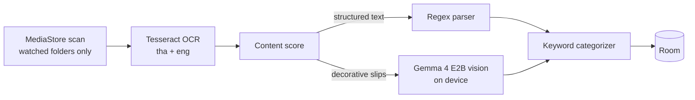

# Sauron

Thai bank payment slips in, categorized expenses out. Local only.


Sauron is an Android app that turns Thai payment slips into a categorized expense list. Save a slip from a supported bank app and Sauron picks it up in the background, reads it, extracts the amount, the merchant, and the time, and files the expense under a category. No account. No server. No bank login. Financial data never leaves the phone.

## Supported banks

| Bank app | Watched folder |
| --- | --- |
| K PLUS (Kasikornbank) | `Pictures/K PLUS` |
| SCB EASY | `Pictures/SCB EASY` |
| CLICX | `Pictures/CLICX` |

Save a slip from the bank app and it becomes an expense within 15 minutes, or at the next app open. The main screen shows a scanning bar while a pass runs and counts slips that wait to be read. Screenshots are not scanned.

## How it works



The Gemma stage needs its model file, about 2.0 GB. On first launch the app offers a one-tap download over WiFi and runs it as a foreground service. Until the model is present the app skips the Gemma stage and saves the retry budget.

Money is stored as integer satang, so 12.50 THB is 1250 and arithmetic stays exact. The Room schema is exported per version under `app/schemas`.

## Build

Runs on Android 8.0 and newer. Building needs JDK 17 and an Android SDK; the SDK manager fetches platform 37 on the first build.

```bash
./gradlew assembleDebug        # debug APK in app/build/outputs/apk/debug/
./gradlew testDebugUnitTest    # JVM tests for the domain logic
adb install -r app/build/outputs/apk/debug/app-debug.apk
```

Grant the photo permission on first open. Tap the model card once to download the Gemma weights. Releases are tagged `v*` and built by GitHub Actions.

## Project layout

```text
app/src/main/java/dev/fireforge/sauron/
├── ingest/    # MediaStore scan, OCR worker, model download worker
├── domain/    # pure Kotlin: parser, rules, banks, money (JVM-tested)
├── ai/        # Gemma reader through LiteRT-LM
├── data/      # Room entities, DAOs, migrations, hand-rolled DI
└── ui/        # Compose Material 3 screens
```

`testdata/slips/` holds generated slip fixtures and the first real one. `make_slips.py` regenerates them.

## Design notes

`docs/architecture.md` records the stack choices, the pipeline phases, the measured OCR tuning, and why the design looks the way it does.

## Limitations

- Three banks with fixed folder names. More banks arrive as their folders are discovered on real phones.
- Screenshots are never scanned, by design.
- The Gemma model is one 2.0 GB GPU build. Odd devices cannot use the CPU file without adb.
